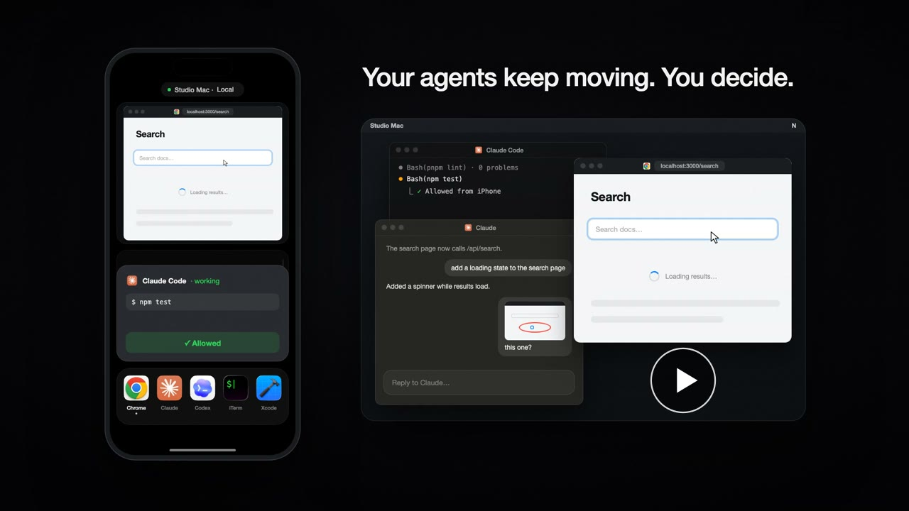
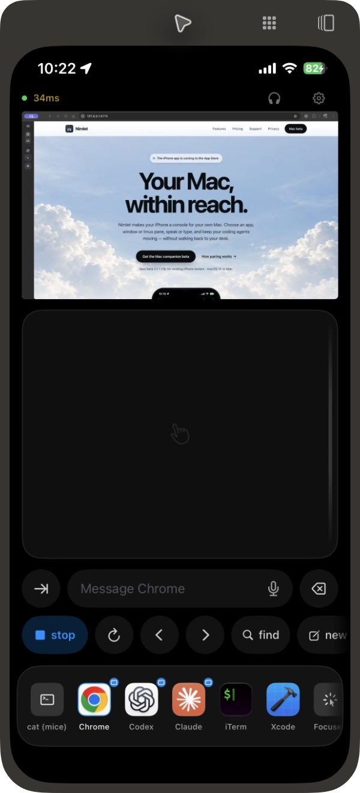

<p align="center">
  
</p>

<h1 align="center">Nimlet</h1>

<p align="center"><strong>Your Mac, within reach.</strong><br>
Your iPhone as a console for your own Mac.</p>

<p align="center">
  <a href="https://testflight.apple.com/join/wEFRKTuA">iPhone beta on TestFlight</a> ·
  <a href="https://nimlet.app/download/">Mac companion</a> ·
  <a href="https://nimlet.app">nimlet.app</a> ·
  <a href="LICENSE">Apache 2.0</a>
</p>

<p align="center">
  <a href="docs/media/nimlet-launch.mp4"></a>
  <br><sub>The 22-second launch film. Click to play.</sub>
</p>

> **Public beta.** iPhone on [TestFlight](https://testflight.apple.com/join/wEFRKTuA) — every feature open, no purchase. Mac companion from [nimlet.app/download](https://nimlet.app/download/). The [0.1.1 (18) connectivity audit](docs/releases/0.1.1-18.md) is kept for its measurements.



Nimlet makes your iPhone a console for your own Mac. Pick where input goes — a Mac app, one of its windows, or a named tmux
pane — then speak or type, and it arrives there. Watch a live preview of that
window, move the pointer with the phone as a trackpad, hear the Mac's sound,
and circle something on its screen and send it back as a picture. When a coding
agent is blocked on you, the phone says so, and you allow or deny it from there.

It starts on your own network: pair once nearby, then reach the same Mac from
away over your own VPN, a direct route, or Nimlet's encrypted relay. Your
agents, editor and terminal stay on your Mac; Nimlet brings no AI model, no
account and no hosted computer. The app has to be open while you drive the
Mac, and the Mac has to stay awake.

The details, roughly in the order you meet them:

- **Hold a target button and talk.** On release the transcript is delivered to
  that target — a tmux pane, an app, or whatever has focus — and Return is
  pressed if you allowed it for that target.
- **Tap a target button** (Claude, Codex, a tmux pane…) to bring it to the front.
  **The cursor goes with it.** Raising a window moves what is focused and
  nothing else, so the pointer stayed over the window you just left — waiting to
  be found, and eating the scroll, which macOS sends to whatever is under the
  pointer rather than to what is focused. Tapping a tile or a window card now
  puts the pointer in the middle of the window you asked for, unless it is
  already in it. Delivering text does *not* move it: sending a sentence
  somewhere is not a statement about where you are working.
- **The buttons change with what is listening.** A pane running Claude Code
  offers stop, rewind, permission mode, its task list and its transcript; a
  pane running Codex offers stop, edit-last, mode and copy-reply; a bare shell
  offers Return, Ctrl-C, Ctrl-D and clear. **A Mac app is asked what its keys
  are**: Nimlet reads that app's own menu bar and builds the row from it, so
  Xcode offers run, stop, build and test, a browser offers reload, back,
  forward and tab-switching, and an app nobody ever wrote a set for still
  offers new, save, find and undo — on the keys *it* publishes, including ones
  you have rebound. Nimlet reads the pane's foreground process to pick a pane's
  set, and you can pin either by hand.
- **Keys go to that target**, not to whatever has focus. For a pane they are
  `tmux send-keys`, so Esc interrupts *that* agent whether or not its window is
  visible — which is the whole point, since text reaches a pane without raising
  it.
- **The targets are a dock.** Horizontal, scrollable, in the order you put them
  in, and an app target wears its own icon — the real one, sent over by the Mac.
  Tap to focus, hold to talk. **Edit** turns on arranging: drag a target into
  place, remove one, or add one. A target with something to report gets an
  indicator under it, the way a running app does in the Dock — and nothing at
  all when it has nothing to say.
- **And it tells you when you are not looking at it.** A dot on a tile is an
  ambient signal on a screen nobody is reading; the whole premise here is that
  the agent works while you do something else. So an agent that is blocked on
  you, one that fell over, and one asking permission each arrive as a
  notification, asking to break through a Focus because that is exactly the
  situation they exist for. A finished turn does **not** — it will still be
  finished when you next look, and an app that buzzes on every completed turn
  is an app whose notifications get switched off inside a week, taking the
  other three with it. You can turn it on if you want it; it arrives quietly.

  What makes it bearable is the part that takes things *down*. An agent that
  finishes removes its own "waiting for you"; an approval answered on another
  phone, expired, or withdrawn by the asker takes its banner with it, buttons
  and all; the second report from one target inside half a minute updates the
  banner without a second buzz, and four agents finishing the same build at the
  same second cost one. Approvals carry **Approve** and **Deny** on the banner
  itself — Deny answers from the lock screen, because a denial that never
  arrives ends in the request expiring, which never approves anything, while
  Approve opens the app and asks for your face first, because a command
  approved from a screen you were not reading is the one mistake here that
  cannot be taken back. A question has no buttons on its banner: tapping it
  opens the question with the agent's own choices. An agent report carries **Mute this target**, for the pane that will
  not stop. Settings → Notifications has the rest: what interrupts you, whether
  it makes a sound, how long it stays quiet afterwards, and a switch per target.

  **And it reaches a phone that is asleep.** Those are local notifications, so
  they only fire while the app is alive — about twenty-five seconds after you
  leave it, or indefinitely while it is playing your Mac's sound. Past that iOS
  freezes the process and nothing sent to it arrives anywhere, which is most of
  an afternoon. So past that the Mac does the deciding: your phone registers an
  APNs token *and the notification rules you set*, and the Mac runs the same
  rules — literally the same code — and pushes only what survives them. A
  target muted on the phone is one the Mac never pushes about. A phone that is
  connected is never pushed to at all, because it is already being told the
  better way.

  **What goes through the relay is sealed.** A push has to be signed with a
  credential belonging to the app's developer account, so one thing has to hold
  it — but it does not have to be able to read what it carries. Nimlet already
  gives every approved phone its own 256-bit key at pairing; the Mac seals the
  notification with that key, and a notification service extension opens it on
  the phone a moment before it is shown. What passes through the relay is an
  opaque device token and ciphertext: not which target, not which agent, not
  what it said, not what command it wanted to run. There is no relay address
  compiled in, either — Nimlet talks to your Mac and nowhere else until you point
  it somewhere on purpose. See [Relay/README.md](Relay/README.md), which is
  four one-time steps and a stateless worker.

  Two honest limits remain. APNs cannot **retract** a notification already on a
  sleeping phone, so the "takes things down" behaviour above is the LAN path's;
  over push, a newer alert replaces an older one and an approval's push simply
  expires at the request's own deadline rather than arriving too late to
  answer. And a push is **not queued** — if the relay is down it is lost, and
  the dock tells you the same thing with an age attached when you next look.
- **Type a message** with the keyboard button beside the quick replies, for
  when neither a canned phrase nor a sentence said out loud is what you have.
- **Attach a picture** to that message — up to eight, from your photo library or
  the camera. A pane cannot be handed bytes, so the Mac writes each image into
  `~/Library/Application Support/Nimlet/inbox/` and sends the pane the paths, which
  is the route every agent reads reliably; an app with a composer is handed the
  pictures themselves. They ride a socket of their own, so the pointer does not
  stop moving while a photo goes up.
- **Or circle it on your own screen.** Tap Screen and the Mac photographs that
  target — the app's window, or the display the pointer is on for a pane — and
  sends it to the phone. Draw on it with a finger and the flattened picture goes
  back as the attachment. "This button, here" is one gesture, where describing
  where it is on screen is a paragraph.
- **Drag** anywhere on the phone to move the cursor. **Tap** to click,
  **double-tap** to double-click.
- **Drag the strip down the right-hand edge to scroll.** One finger, on a
  surface of its own, on both the pad and the full-screen mirror. Scrolling used
  to be two fingers, which meant two fingers had to mean two things and cost a
  fourteen-point argument at the start of every one of them about which.
- **Two fingers are the picture, and never the Mac**: pinch to enlarge the
  mirror, drag to move it around. Identical on the pad and on the mirror itself,
  which is the point — the pad is that gesture at a distance. Nothing is sent to
  the Mac, so the application over there keeps its own zoom, its own layout and
  its own window size; what gets bigger is the picture on this phone. Past about
  3x the Mac starts sending the part you are reading rather than the whole
  window, so it keeps resolving instead of merely growing. Pinching zooms in on
  the cursor, and while you are driving the pointer the picture follows it.
- **Two-finger tap to right-click**, in both places. The mirror had no right
  click at all before; the whole-window toggle it used to be is a button in the
  mirror's header.
- **Windows fit the phone's mirror area automatically.** Connecting, selecting
  another window, and opening or closing the full-screen mirror apply the
  available area's proportions. Dragging the divider still chooses your split.
  Zooming does not resize the Mac window. Apps with a minimum or fixed window
  size keep their allowed dimensions; Nimlet fits the picture without retrying
  the resize continuously.
- **Hold the Air pill** (lower-left of the pointer area) to steer the cursor by
  moving the phone. Drag it anywhere you like; the position sticks.
- **Panel** floats a live tile of whatever target is selected. Drag it anywhere,
  push it off the side to tuck it away, tap it to fill the screen.
- **Hear the Mac from another room.** Tap the headphones above the mirror and
  the Mac's own output mix — every app, not the one you last tapped, because the
  chime that says an agent finished comes from a different process than the
  agent — arrives on the phone as AAC. About 12 KB/s while something is playing
  and almost nothing while it is not, so it is usable on cellular as well as at
  the desk. This is the **one** thing in Nimlet that keeps working with the app off
  screen: it is the opposite of the premise everything else here is built on, so
  it plays with the phone locked and in a pocket, appears on the lock screen with
  a pause button, and follows the route when AirPods arrive. Dictating stops it
  for as long as you hold the button — the microphone is inches from the speaker
  — and it starts again by itself when you let go. Off by default and started by
  you; the Mac has its own switch, *Let phones listen*, for the rooms where the
  answer is no whoever is asking.
- **Set up once, in order.** The app explains the local network before asking
  for it, shows what each permission is for, then finds your Mac, takes the
  pairing code, and waits while you approve the phone by name.
- **Away from home, with nothing to install.** Switch on *Reachable on cellular*
  in the menu bar and the Mac asks your own router for a way in — PCP, then
  NAT-PMP, then UPnP — works out what address that way in has, and hands the
  answer to your phone over the connection you already have. On cellular the
  phone dials it directly. No VPN, no account, no relay, nothing in the middle:
  the only two machines involved are still yours. The port it opens is a
  separate listener with a **256-bit key per phone**, held in the Keychain at
  both ends, so the six characters on your screen do not open it and revoking a
  phone stops it at the handshake. Off by default, and honest when it cannot
  work: if your ISP puts you behind a carrier-grade NAT there is no port to
  forward, and the menu bar says so instead of retrying forever.
- **Hold an app tile for its windows.** Hold it and the
  windows that app has open right now rise out of the dock — each with its title
  and a picture of it. Tap one and the Mac brings *that* window forward, keeps
  it, and the mirror follows it; tapping the tile afterwards goes back to it.
  These are windows, not documents: the ones ⌘` cycles on the Mac, not Claude's
  conversations or a browser's tabs. If the window you picked closes or is
  minimised, Nimlet says so and offers the others — it will not focus, mirror or
  type into a different one.
- **Fill the dock by tapping icons.** The `+` opens the Mac's own applications,
  ranked by how much they are actually used — Spotlight's launch counts weighted
  toward what was opened recently, with whatever is running right now brought
  forward — each with its real icon. Tick the ones you want, tap Add. The live
  tmux panes are in the same sheet. Adding an app used to mean typing
  `com.todesktop.230313mzl4w4u92` into a phone keyboard from memory.
- **Edit the target list from the phone.** Rename one, point it at another pane,
  or remove it. Each pane is described by the window it is in and what is
  running there, not by the pane id Nimlet stores. A target whose pane has closed
  says so instead of silently swallowing text.
- **Answer an agent that is waiting for you.** A permission prompt or a
  question from Claude Code appears on the phone with the choices the agent
  offered — Approve, Deny with a reason, "don't ask again", or the options of
  its question, or your own typed answer — and the answer goes back to the
  session that asked. Nothing is approved by not answering: when the wait set
  on the Mac runs out, the agent's own prompt is still there on the Mac.

Speech uses on-device transcription when available. The older recognition
fallback may send audio to Apple when on-device recognition is unavailable;
only the resulting text is sent to your Mac, over a TLS connection keyed by the
pairing code — or, away from home, by that phone's own 256-bit key. Audio travels
the other way only when you ask: the Mac sends its output to a phone that has
switched listening on, over a separate TLS connection, and captures nothing
while nobody is listening. Note the
one honest caveat — text delivered to an `app` or `frontmost` target goes via the
macOS general pasteboard, and Universal Clipboard can sync that to your other
devices. `tmux` targets do not touch the pasteboard. See [PRIVACY.md](PRIVACY.md).

A device that knows the pairing code still cannot type anything until you
approve it by name in the menu bar. See [SECURITY.md](SECURITY.md).

## Why a Mac helper app and not Bluetooth

iOS cannot be a Bluetooth HID keyboard or mouse. Apple blocks the HID service
UUID (`0x1812`) in `CBPeripheralManager` — adding it fails with *"The specified
UUID is not allowed for this operation."*

That is the reason for the pointer half. The better reason for the Mac app is the
delivery half: no HID keystroke stream, Bluetooth or otherwise, can put a
paragraph into a *named* tmux pane without raising a window. Addressing a
destination needs something running on the Mac that knows what the destinations
are.

## Layout

```
Shared/          wire protocol + TLS-PSK transport, compiled into both apps
NimletHost/        macOS menu bar app: Bonjour listener, CGEvent injection, routing
NimletRemote/      iOS app: trackpad surface, target buttons, on-device dictation
Tools/nimlet/    the `nimlet` CLI: pair, list, send, and report agent events
Tests/           unit tests for the wire format, framing and pairing codes
```

## Build and run

Requires Xcode 27 and [XcodeGen](https://github.com/yonaskolb/XcodeGen)
(`brew install xcodegen`).

```bash
make install-host # build Release, install to /Applications, launch at login
make run-host     # build Debug + launch from the build directory instead
make install      # build + install the iOS app on a booted Simulator
make logs         # watch events arrive
```

`make install-host` is the one you want for daily use: `make clean` deletes the
build directory, and a login item registered from there would not survive.
It refuses to replace `/Applications/Nimlet.app` if that bundle is not Nimlet.

The Accessibility grant follows the app's code signature, so moving between the
build directory and `/Applications` does not normally require re-approving it.

For your actual phone, unlock it, connect it, and `make install-device`. It
signs with your team's automatic profile and pushes the Release build over
`devicectl`; `xcrun devicectl list devices` has to say **connected** first.
Opening `Nimlet.xcodeproj` after `make project` and running the `NimletRemote`
scheme works too. Dictation **only works on a real device** — see Known limits.

### Real iPhone and Mac debugging

iPhone Mirroring provides the phone UI. It does not provide the phone's logs
or make the phone an Xcode run destination. Connect the phone by USB, unlock it,
and confirm Trust on the phone. Check Developer Mode when Xcode requests it.
See Apple's [device setup](https://developer.apple.com/documentation/xcode/enabling-developer-mode-on-a-device)
and [diagnostic logs](https://developer.apple.com/documentation/xcode/acquiring-crash-reports-and-diagnostic-logs).

The local evidence collector uses Xcode and `libimobiledevice`:

```bash
brew install libimobiledevice
python3 Scripts/debug-session.py doctor
python3 Scripts/debug-session.py capture --seconds 180
# Optional: include an existing, authorized relay SSH alias.
python3 Scripts/debug-session.py capture --seconds 180 --relay-ssh <alias>
```

`doctor` must show a **physical** phone as `connected` and
`debugServicesAvailable: true`. It exits with status 2 when the phone is missing
or its development services are not ready (for example, it is locked).
`capture` leaves the apps running and writes
Mac logs, phone process logs, and a combined UTC receipt timeline under
`build/debug-sessions/`. Each original log retains its own event timestamp.
Receipt timestamps align collection; they do not measure network latency.
Missing phone logs or an early collector exit produces status 2, meaning partial
evidence. The optional relay collector requires existing noninteractive SSH and
`sudo -n journalctl` access. It does not alter server settings.

For breakpoints, build the `NimletRemote` scheme with Debug configuration and select
the physical phone in Xcode. Use `build/debug-device` as a separate DerivedData
directory. Install only after recording the phone's current build and reproducing
the issue; installing a development build replaces the same app's TestFlight binary.
Do not uninstall or reset pairing as part of environment setup.

```bash
xcodebuild -project Nimlet.xcodeproj -scheme NimletRemote -configuration Debug \
  -destination 'generic/platform=iOS' -derivedDataPath build/debug-device build
# Explicitly relaunch the installed app with its stdout/stderr console attached:
python3 Scripts/debug-session.py console
# Copy device crash reports without relaunching the app:
python3 Scripts/debug-session.py crashes
```

`console` is a separate mode because it restarts the app. It captures stdout and
stderr; use `capture` or macOS Console with the phone selected for unified system
logs. In Console, enable Info and Debug, then filter for subsystem
`com.renyicao.mice`. Use Xcode/LLDB for stack traces and breakpoints on a development
build. Crash copies include device crash reports, so keep them local.

Record control, picture, and audio as separate channels. A green control latency
and a successful `hello` do not prove a picture socket is connected. Match
`panel dialing/ready/waiting/failed` on the phone with `client ready` and `view:`
on the Mac, plus `phone: open/spliced` on the relay. Reproduce foreground return
and Wi-Fi/cellular handoff while capture runs. Logs can contain private app
metadata; capture directories are private and excluded from Git.

For controls that remain dim after connecting, compare `host status: approved=true`
with `control surface: operable=true` on the phone. The first confirms the Mac's
approval; the second confirms the touch surface has enabled input. Check a real
Dock action on the Mac as well as the phone's live picture.

### First run

1. Launch the Mac app. A **setup window** opens with the four steps below and
   ticks each off as it happens; it is reopened any time from the menu bar
   (**Setup guide…**). macOS asks for **Accessibility** permission. Grant it.
   Without it, `CGEvent` injection silently does nothing — no error, no clicks,
   no typing. The phone shows an orange warning when the grant is missing.
2. Read the six-character **pairing code** in the setup window or the menu bar.
3. Open the app on the phone, pick your Mac, type the code.
4. The phone appears on the Mac by name, in a small floating prompt and in the
   menu. Approve it. Knowing the code alone lets a device connect, not type.

The Mac companion checks `nimlet.app` for a newer build about every six hours
and says so in its menu; it never installs anything by itself. See
[PRIVACY.md](PRIVACY.md) for exactly what that request carries.

## Launch at login

Handled with `SMAppService`, toggled from the menu bar item. The toggle only
appears once Nimlet is in `/Applications` — registration from a build directory
does not stick, and an inert toggle is worse than none. `make install-host`
enables it for you; turn it off again from the same menu.

## Targets

A target is somewhere text can be delivered. Edit them in **Settings…** from the
menu bar item. Three kinds:

| Kind | What it does |
|---|---|
| `app` | Raises an app by bundle ID, then pastes |
| `tmux` | `tmux send-keys` straight into a pane — no window focus needed |
| `frontmost` | Pastes into whatever already has keyboard focus |

An `app` target can be narrowed to one **window**. Hold its tile on the phone
to see what that app has open, and pick one. From then on
that target means that window: focus raises it, text goes to it, and the panel
mirrors it. Nothing falls back — a window that has closed or been minimised is
reported, and the shelf opens on the windows that are still there, because the
alternative is a sentence typed into the wrong conversation. "Any window" puts
the target back to following whichever window the app puts in front.

Window titles come from Accessibility, which Nimlet already holds; the pictures
come from Screen Recording, which it only asks for when you first mirror
something. Without that second grant the shelf still works, with titles instead
of thumbnails.

For CLI agents, prefer a **tmux** target. It lands in the right pane whether or
not the terminal window is visible, which is far more reliable than raising a
window and hoping focus follows.

On first launch the app seeds a handful of targets: the apps Nimlet is for —
agents, terminals, editors, the browser — filtered to what is installed and
ranked by how much this Mac actually uses each one, so a machine with four
terminals on it does not open to a dock of all four.

Everything after that is added from the phone. The `+` in the dock opens the
Mac's applications as a grid of their own icons, best first, with the live tmux
panes under them; tick what you want and tap Add. The ranking is Spotlight's own
launch count per app, weighted toward recent use, with a nudge for what is
running, what is in your Dock, and the kinds of app Nimlet exists to talk to — the
count is capped, so a browser opened twenty-six thousand times cannot own the
top of the list. Nothing is added without you tapping it.

They can also be edited from the phone — the slider button above the target
grid, or **Targets…** in its settings. The Mac still owns the list: every change
is a request, and what comes back is the Mac's new list rather than the phone's
guess at it, because the Mac is the only end that can tell whether a pane still
exists or an app is installed. A `frontmost` target is the exception and has to
be made on the Mac: it types into whatever happens to be in front, which is not
a thing to aim from another room.

## Answering an agent from your phone

On the Mac, **Settings → Agents → Answer agents from your phone** installs one
`PermissionRequest` hook for Claude Code (`~/.claude/settings.json`) and, when
`~/.codex` exists, for Codex (`~/.codex/hooks.json`). It runs `nimlet answer
--hook`, which puts what the agent is asking on every approved phone and in the
Mac's menu bar, waits, and prints the answer back for the agent:

- **A permission prompt** — "Run a command? `npm test`" — is answered with
  Approve, Deny (with a reason, which reaches the agent so it changes course
  instead of asking again), or Claude Code's own "don't ask again", which adds
  exactly the rule or session mode Claude offered.
- **A question** — Claude Code's `AskUserQuestion` raises the same hook — shows
  its questions and choices, single or multiple, and a field for your own
  answer. The answers go back as if you had picked them in the terminal.

The answer reaches the right session by construction: the hook that is waiting
is that session's own. Tap the notification or the "waiting for you" banner
above the dock and the card for that request opens — also when the tap is what
launched the app. The target's tile keeps its yellow dot while it waits.

**How long it waits** is **Settings → Agents → Wait for an answer**: 2 minutes,
10 (the default), 30, an hour, 4 or 12 hours. When it runs out nothing is
approved — the card comes down and the agent's own prompt is still on the Mac,
waiting for you there. The hook is installed with a `timeout` past the longest
wait, because Claude Code otherwise ends a hook at ten minutes.

How each agent behaves, measured on Claude Code 2.1.289 and Codex 0.153.4:

- **Claude Code** (terminal and the Claude desktop app) shows its own prompt
  while the hook waits, and the first answer wins. Answer in the terminal and
  Claude ends the hook, so the phone's card comes down within seconds.
- **Codex** shows its prompt only after the hook returns. So `nimlet answer`
  holds it for the phone only while nobody is at the Mac — the screen is
  locked, or there has been no input for a minute — and otherwise just tells
  the phone "waiting for you" and lets Codex ask at once. Codex's own question
  tool (`request_user_input`, Plan mode) cannot take an answer from a hook, so
  for it the phone shows the question and its choices and you answer at the
  Mac. The menu bar's **Answer in the agent instead** releases a held prompt.
- **The Mac restarting its listeners** — waking from sleep, changing network —
  drops the hook's connection. The hook dials back in and asks again under the
  same id; the card waits 30 seconds for it before coming down.

The **Stop** hook takes a "waiting for you" down when a run finishes — and, for
Codex, so does `Interrupt`, because declining its prompt with Esc aborts the
turn instead of ending it.

It does not matter where the agent runs. In a tmux pane the pane is the
target. Anywhere else `nimlet` walks up its own ancestors to the app it is
running inside — Claude.app for the Claude desktop app, ChatGPT.app for
ChatGPT's Codex, iTerm for a terminal without tmux — and uses an `app` target
for that bundle if you have one. Failing both, it reports as "Claude Code" or
"Codex", so the notice arrives either way.

Things to know:

- **Updating Nimlet updates hooks it installed before**, keeping a copy of each
  file beside it. **Codex runs a new or changed hook only after you trust it**:
  type `/hooks` in a Codex session once; ChatGPT's Codex reads the same trust.
- **Codex only asks when it is allowed to.** With `approval_policy = "never"`
  in `~/.codex/config.toml` there is never a prompt, so never a notice.

## Approving what an agent wants to run

A coding agent that stops to ask permission stops everything behind it. The
phone is already what you reach for when a run needs a word from you; this is
the same reach for the moment it needs a decision.

Claude Code asks permission only for what its own rules do not already allow.
To have *every* shell command wait for the phone, **Settings → Agents → Ask the
phone before every Bash command** installs a `PreToolUse` hook in
`~/.claude/settings.json` that runs `nimlet gate` before every `Bash` call. `gate` reads the hook's payload, puts the command on your phones,
and blocks until somebody answers — exit 0 to allow, exit 2 to block, with
your reason handed back to the agent. The same screen installs the `Stop` hook
that tells the phone when a run finishes, and pairs and approves the tool with
one click. By hand, the equivalent is:

```bash
/Applications/Nimlet.app/Contents/Helpers/nimlet hook --approve   # prints the snippet
```

Neither hook names a target: the tool is matched to its target by the tmux pane
the agent runs in (`$TMUX_PANE`), so every pane that is a Nimlet target reports
for itself. Pass `--target NAME` to pin one instead.

Two rules hold everywhere in this path:

- **Nothing is approved by not answering.** Every request carries its own
  deadline. When it passes, the gate is told no and `nimlet answer` leaves the
  agent's own prompt in place. A phone in a pocket, a closed app, a dropped
  Wi-Fi link and a sleeping Mac never end in the agent proceeding because the
  answer was slow.
- **The asker always gets an answer.** Answered, expired, withdrawn because the
  agent died, or refused because too many were already waiting — each one sends
  a resolution back. An agent blocked on a pipe that never writes is worse than
  an agent denied.

Either end can answer: the card appears on every approved phone *and* in the
menu bar, and the first answer wins. `nimlet pending` and `nimlet decide` do the
same thing from a terminal.

The window is the **Wait for an answer** setting (10 minutes unless changed;
`--for SECONDS` overrides it for `ask` and `gate`, capped at 12 hours). At most
eight requests wait at once; the ninth is denied rather than queued behind a
screen nobody is watching.

## The `nimlet` CLI

A headless client. Useful for driving the Mac from a script, for reporting agent
state from a hook, for answering approvals, and for testing delivery without a
phone. It ships inside the Mac app, at
`/Applications/Nimlet.app/Contents/Helpers/nimlet` — in `Helpers`, not `MacOS`,
so a case-insensitive disk never has to hold the app's executable and `nimlet`
side by side — and `make tool` builds a copy at `build/nimlet`
for working on it.

```bash
nimlet=/Applications/Nimlet.app/Contents/Helpers/nimlet

$nimlet pair --code ABC123    # stored 0600 in ~/.config/nimlet/config.json
$nimlet list
$nimlet target remove keytest
$nimlet send --target Claude "summarise the diff"
git diff | $nimlet send --no-submit
$nimlet event done              # inside a tmux pane: that pane's target
$nimlet event done --target "claude (work)"
$nimlet menu com.apple.dt.Xcode # what Nimlet reads in that app's menu bar
$nimlet hook                    # prints a Stop-hook snippet; installs nothing

$nimlet ask --title "Run a command" --target claude "rm -rf build/"
$nimlet pending
$nimlet decide <id> deny --reason "wrong directory"
$nimlet hook --approve
```

`nimlet` is approved and revoked on the Mac like any other device, so the first
`send` will be refused until you approve it — **Settings → Agents → Pair with
this Mac** does the pairing and the approval together.

Being honest about what this buys you: for a tmux target, `nimlet send` is a
Bonjour lookup and a TLS handshake to do what `tmux send-keys` does directly.
It earns its place for `app` and `frontmost` targets — raise by bundle id,
paste, press Return — which `osascript` does badly, and for `nimlet event`, which
fans out to every connected phone.

## Design notes

**Pointer acceleration** is what makes a 390pt phone surface able to drive a
multi-thousand pixel desktop. Slow movement stays near 1:1 for precision; fast
movement earns up to ~5x. The curve smooths the *speed estimate* rather than the
delta, because smoothing the delta adds visible pointer lag.

**Haptics carry the feedback** that a blind trackpad cannot show you. Clicks,
drag start/end, and record start/stop each have their own tap.

**Two-finger latch.** Landing or lifting two fingers is never simultaneous, so
there are frames where only one touch is live. Without a latch those frames read
as pointer movement and the cursor drifts away during every scroll.

**Long dictation is pasted, not typed.** Per-character `CGEvent` synthesis is
slow and some apps drop characters when it outruns their input handling. The
previous clipboard contents are restored afterwards.

**Speech** uses iOS 26's `SpeechAnalyzer` / `SpeechTranscriber`: on-device, no
one-minute session cap, and no requirement that the user has switched on Siri or
keyboard dictation. `SFSpeechRecognizer` is the fallback and may use Apple's
servers when on-device recognition is unavailable.

**The mirror's bitrate is measured, not chosen.** It used to be picked from the
name of the interface — 12 Mbps on Wi-Fi, 2.5 over AWDL — and then never
revisited, which is fine right up until the link cannot carry it. `NWConnection`
says when it has taken a frame, and the interval between handing one over and
that acknowledgement is the only honest throughput signal a TCP sender gets:
while the socket has room the write returns at once, and once it is full the
write is paced by the link itself. So a frame the transport was slow to accept
is both the congestion signal and the bandwidth sample. `VideoPacer` probes
upward in small steps while nothing goes wrong and cuts hard the moment
something does, because growing slowly costs a little sharpness and shrinking
slowly costs a frozen picture. Those interface numbers are still there as
ceilings.

**Keyframes are asked for, not scheduled.** There used to be a two-second safety
net as well as the explicit requests, and on a screen that is actually moving —
a video playing, a long scroll — the net fired every time. A keyframe of a
2560-wide window is tens of times the size of the delta frames around it, so
every two seconds the link was handed a burst it could not absorb inside one
frame interval: the mirror stopped for as long as that took, and because the
Mac's audio is a second TCP flow over the same Wi-Fi, the sound stopped with it.
The net is now ten seconds, and everything that actually needs a keyframe asks
for one — a viewer attaching, resizing or flushing its renderer, the mirror
changing windows, a frame this side had to discard, and a phone whose reader
lost its place in the stream.

**The picture is held to meet the sound.** The two channels are treated
oppositely by design: a video frame goes on the glass the instant it lands,
while audio comes out of a cushion sized to the link. That gap is the cushion's
whole width, which nobody notices on a terminal and everybody notices on a face.
Both channels already stamp every frame with the same host clock, so the
correction needs nothing new on the wire — while the phone is playing the Mac,
each video frame is held until the moment its own audio is due. It is bounded at
280 ms, because past that the mirror is no longer something you can drive and a
residual lip-sync error is the better of the two faults. Nothing is held at all
when nobody is listening.

## Shortcut sets

What belongs on the phone depends entirely on what is at the other end. Escape
interrupts an agent and does nothing at a shell prompt. Ctrl-C kills a command
but quits an agent outright. ⌘C is the terminal's own shortcut and never
reaches a pane at all. One fixed row of keys can only ever be right for one of
them.

| Set | For | Buttons |
|---|---|---|
| Claude Code | a pane running `claude` | stop · rewind · mode · clear · tasks · log · its mic · talk |
| Codex | a pane running `codex` | stop · steer · queue · clear · mode · edit last · talk |
| Shell | any other pane | run · ^C · ^D · clear · wipe · talk |
| Browser | Safari, Chrome, Firefox, Edge, Arc, the Chromium forks | reload · back · forward · next tab · prev tab · find · address · talk |
| Code editor | VS Code, Cursor, Windsurf, Zed | palette · open · save · find · find all · terminal · sidebar · talk |
| Xcode | Xcode | run · stop · build · test · open · clean · talk |
| Chat app | Claude, ChatGPT | new chat · send · newline · talk |
| Terminal app | Terminal, iTerm, Ghostty, WezTerm, kitty, Alacritty, Warp, Hyper | run · ^C · ^D · clear · wipe · find · talk |
| Mac app | any other app, and the frontmost target | esc · return · ⌘C · ⌘V · talk |

Every one of those is a fallback for an app whose menus could not be read.

**steer** and **queue** are the distinction Codex makes and nothing else does:
a message sent while a turn is running either redirects that turn now or waits
behind it. **clear** throws away what is typed without sending it; for a shell,
**wipe** clears the screen instead, which is a different clear.

A pane's set is chosen from its foreground process. An app's is **read from the
app**.

### Reading an app's menu bar

A curated table can only ever be right about the apps somebody listed, on the
keys they had that year. So for an app target, Nimlet asks the app: it walks that
app's menu bar with the Accessibility grant it already holds — the same grant it
uses to press the keys afterwards — and builds the row out of what it finds.
Nothing is guessed: every chord on a discovered row is one the app publishes for
itself, named on the button with where it came from ("Xcode's own key for
Product ▸ Run").

A menu bar holds a couple of hundred shortcuts and the row holds twelve, so the
*what* is curated and the *which key* is discovered. Nimlet looks for about twenty
things worth a button — run, stop, build, test, reload, back, forward, save,
find, the command palette, a terminal, a sidebar, new, tab-switching, the
address bar, undo, redo, copy, paste — in that order, and takes the app's own
key for each. Ranking two hundred items by how common or how deep they are
produces a plausible row of the wrong things: Print, Hide, Minimise and Select
All all rank well, and none of them is why anybody picked up their phone.

What that buys, which the table could not:

- **A key you rebound is the key that gets pressed.** Move Run to ⌃⌥R and the
  run button presses ⌃⌥R.
- **An app nobody listed still gets a row** — new, save, find, undo and the
  rest, from its own menus.
- **A menu bar in another language works.** The menus a want prefers are
  searched first and the rest of the bar after them, so an Edit menu called
  编辑 still yields undo and copy.

It is read on demand — when a target is focused, not on every launch — cached
per app for five minutes, and refreshed from the target's settings on the phone
or with `nimlet menu BUNDLEID --refresh`. Reading Xcode's 207 shortcuts takes
about a quarter of a second, once.

Two things it will not do. A chord that arrives with no modifier at all is
dropped rather than offered: some apps publish an accelerator the Accessibility
API cannot describe and it comes back as a bare letter, and a bare letter posted
at a window does not run a command, it types one. And an app that is not
running, or whose menus yield fewer than three recognisable things, falls back
to the curated set below rather than showing a row with a single Paste on it.

### When the app cannot be asked

The curated sets are the fallback, and the override: pinning one in the target's
settings is how you say the reading is wrong. An app nobody has described keeps
the plain set rather than the nearest-looking one — a browser's ⌘L in an app
that uses it for something else is a button that quietly does the wrong thing,
which is worse than a button that does little. A channel build is treated as the
app it is a channel of, so `com.google.Chrome.canary` gets the browser set.

A target is only offered the sets it could use: a pane cannot receive a ⌘ key,
and a window cannot be sent `tmux send-keys`.

**talk** is this phone's microphone — transcribed on-device when available,
with possible Apple service fallback, and sent to the Mac as text.
**its mic** is the agent's own dictation, through the Mac's
microphone; Claude Code binds it to Space and records while the key is held, so
from a phone it needs `/voice tap` first, which makes one press start and stop
it. Codex carries a `toggle_voice_mute` action in its keymap but ships no
default key for it, so that button is listed unbound rather than guessed at.

These are defaults, not truths: these tools rebind their own keys between
releases, and every app here lets you rebind yours. Every set is listed in the
target's settings with the exact chord it sends, so a wrong one is visible
rather than mysterious.

## Known limits

- **A shortcut set is a guess until you check it.** Nimlet reads the pane's
  foreground process name, which is wrong whenever an agent runs under a
  wrapper or a different name — and a pane running `node` says `node`. Pin the
  set by hand in that case.

- **Pressing Return from the phone works even on a target set to never press
  Return.** That policy is about Nimlet pressing it as part of delivering text —
  the case where a dictated sentence could run unattended. The Return key is
  you pressing it, deliberately, after reading what landed, which is what the
  setting's own description says happens instead.

- **The `PreToolUse` contract behind `nimlet hook --approve` has not been
  round-tripped against a live agent here.** (The `PermissionRequest` hook
  behind `nimlet answer` has, on 2026-10-14: approve, deny with a reason,
  "don't ask again", a question answered, an answer at the terminal taking the
  card down, the wait running out, and a restart of the Mac app mid-wait.)
  The approval path itself has:
  asking, answering from the phone, answering from a terminal, expiry, denial
  with a reason, and the card coming down on a second phone were all exercised
  end to end against a running host. What has not been proved is that *your*
  agent reads exit 2 from that hook as "do not run this". Try it once on
  something harmless before trusting it.
- **The Simulator cannot drive horizontal scrolling at all**, so nothing about
  the dock's scrolling can be judged there — a synthetic drag starting between
  two tiles, where no gesture of ours exists, does not scroll either. Test that
  on a device or not at all.

- **A tappable thing inside a scrolling row has to be a control, not a
  gesture.** A SwiftUI gesture on a child of a `ScrollView` stops it panning,
  and `.simultaneousGesture` does not change that — confirmed twice on a
  device. The dock's tiles are buttons whose style reports `isPressed`, because
  a scroll view cancels a *control's* touches when a pan begins and needs no
  arbitration to do it. See `TilePress` in `NimletRemote/TargetDock.swift` before
  reaching for a gesture there again.

- **Dictation does not work in the iOS Simulator.** `SpeechTranscriber.isAvailable`
  is `false` there, and `SFSpeechRecognizer` fails with *"Failed to initialize
  recognizer"*. Everything else — discovery, pairing, pointer, clicks, scroll,
  target routing, text delivery — does work in the Simulator. `make install`
  targets the Simulator, so use `make device` for anything involving voice.
- The cursor is clamped to the nearest active display, so an L-shaped
  arrangement no longer has a gap the cursor can be parked in.
- The phone has to be on screen to drive the Mac, but leaving the app no longer
  ends the session: iOS gets asked for a task assertion and the connection is
  held for about 25 seconds, so checking a message or copying a token out of
  another app and coming back costs nothing. Past that the socket goes — iOS
  freezes the process and a frozen TLS connection never recovers — and the app
  redials the same Mac on its own when it comes back. While that redial is in
  flight the screen you left is held in place, dimmed, rather than replaced by
  the pairing screen — including after iOS has terminated the app outright for
  its memory, because the dock is kept on the phone and drawn from the last
  session while the Mac is dialled. Six seconds without an answer and the
  recovery screen takes over, which is the point at which it can actually help.
  None of that changes away from home: away access changes where the Mac can be
  reached from, not what iOS does to a backgrounded socket.
- **Away access needs your Mac's own connection to accept an inbound one.**
  Three things can stop it, and Nimlet tells you which: a router with UPnP, NAT-PMP
  and PCP all switched off (turn one on, or forward TCP 61423 by hand and Nimlet
  will pick it up), a router that forwards but will not say what its public
  address is, and a carrier-grade NAT at your ISP, which no amount of asking can
  get around. The last one needs a relay, and Nimlet has none.
- **The phone's address does not matter, and that is deliberate.** Only the Mac
  has to be reachable, so a phone behind a carrier's NAT — which is every phone
  on cellular — dials out perfectly well. There is no hole punching here, and
  there could not be: `NWParameters.requiredLocalEndpoint` and
  `allowLocalEndpointReuse` do not work for UDP, which Apple's DTS confirms
  against FB13678278 and which was still true in macOS 26.
- **If your Mac's address changes while you are away, the phone has a stale
  one** until it is next on your network, where the Mac re-pushes the list on
  every connection. Nothing publishes it anywhere, which is the trade: no
  directory to look your Mac up in, and no way to learn a new address from afar.
- Air pill axis signs and gain could not be verified without a device. If
  steering goes the wrong way, invert that axis in the app's own settings —
  the gear beside the connection status. These used to be documented as
  `defaults write` keys, which on an iPhone is not a thing anyone can do.
- The Simulator reports `isDeviceMotionAvailable` as true on current Xcode, so
  the Air pill appears there — but the motion it reports is not a real gyro, so
  steering does nothing useful. Judge the pill on a device. `mice.air.forceShow`
  forces it visible if some future Simulator hides it again.
- Scroll events go to the window under the pointer, not the focused window —
  that is how macOS works, but it surprises people. Switching window or app from
  the phone takes the pointer with it, which is what makes the next scroll land
  where you expect; a window switched on the Mac itself still does not.
  `defaults write com.renyicao.mice.host mice.followPointer -bool NO` turns the
  pointer move off and leaves focus alone.
- Past about 3x the Mac stops sending the whole window and starts sending the
  part you are reading, at the resolution that part deserves, so zoom keeps
  resolving instead of merely growing. Below 3x nothing is cropped, because
  cropping costs a keyframe and measurably does not help there.
- **The mirror gets softer before it gets slower**, and that is deliberate. When
  the link cannot carry what is being sent, the rate comes down within a frame
  or two and stays down until a run of clean frames earns it back. A blurrier
  picture that keeps moving beats a sharp one that stops every couple of
  seconds — but it does mean a busy network shows up as a loss of detail rather
  than as an error anybody could report. `defaults write
  com.renyicao.mice.host mice.instrument -bool YES` logs the rate being sent and
  the rate the link is measured at, once a second.
- **The frame rate is the encoder's real lever at low bitrates, not the frame
  size.** Measured against the hardware HEVC encoder at 1920x1200 in motion, a
  frame does not come out smaller than about 10 KB whatever rate it is asked
  for; asked for less, it emits fewer frames instead. Two consequences, both
  load-bearing. The encoder has to be told the frame rate that is actually
  reaching the phone, because `ExpectedFrameRate` is how it turns a bitrate into
  a per-frame size: told 60 while twenty go out, it asks itself for frames a
  third the size it can make, abandons the target and emits sixty anyway — 1.5
  Mbps requested, 4.5 measured, on precisely the link that provoked the
  back-off. Told the truth it lands within a fifth of target from 700 kbps to
  8 Mbps. And the frames it
  declines to emit come back through its handler as a nil sample buffer, which
  the sender now counts: it used to give its in-flight slot back only on
  success, so one frame dropped inside the encoder stopped the mirror until
  something restarted the capture.
- **Adaptive bitrate has been simulated, not run against a real congested
  network.** The loop was driven closed — the real encoder, the real controller,
  the real admission rule — against a link of a fixed capacity whose socket
  drains at that capacity, 1280x800 of continuous motion for eight seconds
  each:

  | link | delivered | of the link | worst backlog | frames encoded then dropped |
  | --- | --- | --- | --- | --- |
  | 25 Mbps | 60 fps, 10.9 Mbps | 44% (the ceiling, not the link) | 0 ms | 0 |
  | 6 Mbps | 59 fps, 3.8 Mbps | 64% | 54 ms | 0 |
  | 2.5 Mbps (AWDL) | 59 fps, 2.2 Mbps | 90% | 59 ms | 0 |
  | 2 Mbps | 27 fps, 1.2 Mbps | 59% | 165 ms | 0 |

  The backlog column is the one that says the fault is gone: it is the latency
  the mirror runs at, and it stays bounded instead of growing. Two things that
  simulation cannot tell you, though, and they are the two that matter most: a
  real access point buffers, so `contentProcessed` is a coarser signal than it
  is here, and a real network's capacity moves while you are measuring it.
- **The controller deliberately leaves the link part empty**, between a tenth and
  half of it depending on how hard it has had to back off. That is the audio
  socket's share, and the pointer's: they are on their own TCP flows to the same
  phone, and a mirror that used every last bit would be taking it from them.
- **A/V sync is bounded at 280 ms, so AirPods will not fully converge.** The
  correction covers the network, the cushion and the route's own output latency,
  and Bluetooth headphones can be a fifth of a second of that on their own. On
  the phone's speaker the hold lands comfortably under the cap; on AirPods it
  will sit at the cap with a small residual error, which is the cost of not
  making the mirror unpointable while somebody is listening.
- **Window capture could not be verified here**, because Screen Recording had
  not been granted. The tmux text path is verified end to end, and so is
  everything downstream of capture — encode, parameter sets, framing, decode —
  but `SCStream` itself has only been reasoned about, not run.
- Two copies of Nimlet on one Mac are indistinguishable on the phone, and Bonjour's
  own "(2)" suffix moves around as instances come and go. While working on Nimlet,
  name one: `open -n Nimlet.app --args -mice.serviceName "Nimlet Dev"`. `make
  run-host` also `pkill`s every running copy, including another worktree's.
- A minimised window stops producing frames. Nimlet says so rather than leaving
  the last frame on screen looking live.
- **A window that is not being redrawn cannot be captured.** The filter keeps
  working when a window is merely covered, but macOS suspends drawing for a
  window that is fully occluded, and nothing renders at all behind the lock
  screen — ScreenCaptureKit then returns `idle` for every frame at 60 Hz. Nimlet
  says "Your Mac is locked" for that case; for occlusion it can only show the
  last frame it got.
- **Listening has not been run against a phone.** Everything under it has:
  `SCStream` capture, AAC encode, framing and decode end to end against a real
  host over TLS; the ring under a producer and a consumer at four million frames,
  in order, with the full-buffer path exercised; and the render callback itself
  driven through an `AVAudioEngine` graph offline — silence on an empty buffer,
  the cushion held before it starts, fifty thousand samples in order with no
  gaps, a dropout growing the cushion, and a burst past the ceiling skipped back
  to it. But the far end of every one of those was `nimlet-send --listen` or a
  harness, not an iPhone. What is therefore untested is the part only iOS has:
  `AVAudioSession`, and what actually happens when a call arrives, when AirPods
  connect mid-stream, or when the app is left in a pocket for an hour. Those are
  handled in the code — interruption, route change, media services reset,
  configuration change — and none of them has been seen to work.
  `make listen` is what answers "is the Mac sending anything, and is it
  silence", which are the two questions the phone cannot answer about itself.
- **Listening lights the screen-recording indicator**, because ScreenCaptureKit
  is how the audio is captured and macOS does not distinguish. Nimlet asks that
  stream for two pixels of picture and drops them; nothing of your screen is
  sent. It is still worth knowing that the indicator means "a phone can hear
  this Mac" as well as "a phone can see that window".
- **The cushion is adaptive, which means the delay is not a fixed number.** It
  starts at about 90 ms, grows by a couple of packets every time the buffer runs
  dry, and creeps back down after twenty clean seconds. On good Wi-Fi expect a
  quarter of a second end to end; on a bad link it will trade more delay for
  fewer dropouts without asking, because the alternative is a slider labelled
  "buffer".
- The target row does not scroll by dragging across a button: each button takes
  the drag for its tap-vs-hold timer. Drag in the gap between two buttons.
- **Two fingers no longer scroll, and that is a real adjustment.** It is the
  trade for two fingers meaning exactly one thing: every Mac trackpad in the
  world scrolls that way, so the habit is there and it now enlarges the picture
  instead. When the picture is not zoomed in, a two-finger drag does nothing at
  all rather than scrolling — a silent no-op, which is the honest cost of not
  having the gesture mean one thing at zoom 1.0 and another at 1.1.
- **The scroll strip takes 40 points off the right of the pad and the mirror.**
  A touch that starts there scrolls for as long as it lasts, however far the
  thumb wanders, and nothing else begins while it is running — so a hand resting
  on the glass mid-scroll cannot turn it into a pinch. A finger that starts
  outside it and crosses in is still what it started as.


## Contributing

Bug reports, fixes and ideas are welcome. Start with
[CONTRIBUTING.md](CONTRIBUTING.md), which covers building without the
project's certificates, signing with your own team, and the few identifiers
that still say `mice` and why. Security issues go through
[SECURITY.md](SECURITY.md), never a public issue.

## License

Nimlet is licensed under the [Apache License 2.0](LICENSE); see also
[NOTICE](NOTICE). Third-party components keep their own licenses: KCP, in
`Packages/CKCP`, is MIT, as recorded in
[THIRD-PARTY-NOTICES.txt](THIRD-PARTY-NOTICES.txt).

## Trademarks

"Nimlet" and the Nimlet icon are trademarks of Renyi Cao. The license covers
the code, not the name. You are welcome to build, modify and share the code,
but a fork you distribute, on the App Store or anywhere else, needs its own
name, icon and bundle identifiers so nobody mistakes it for the official app.
Saying that your project is "based on Nimlet" is fine. The icon and the
launch film in `docs/media` are here to show the project, not for a fork to
reuse.
